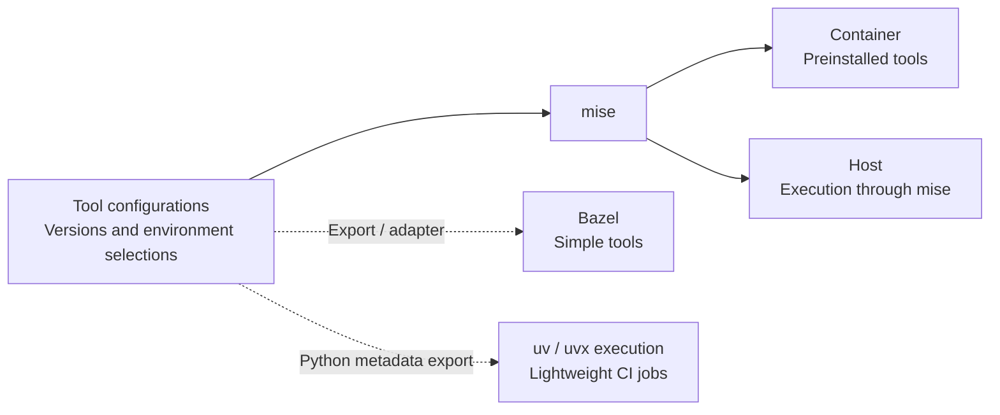
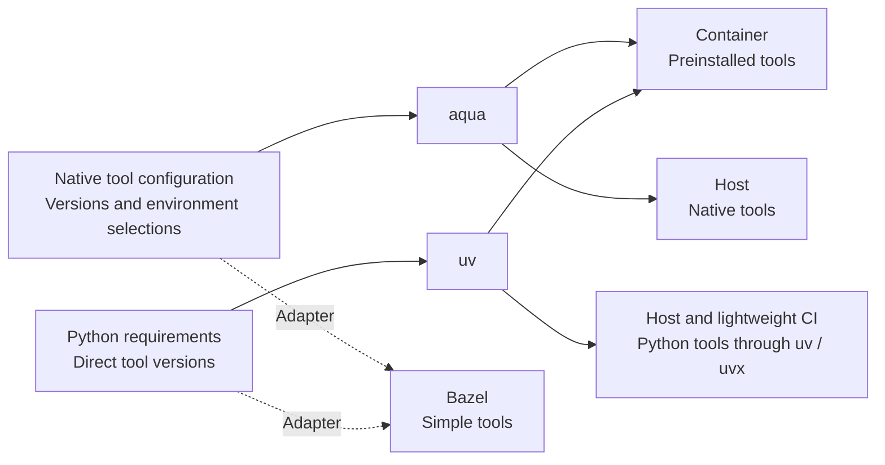
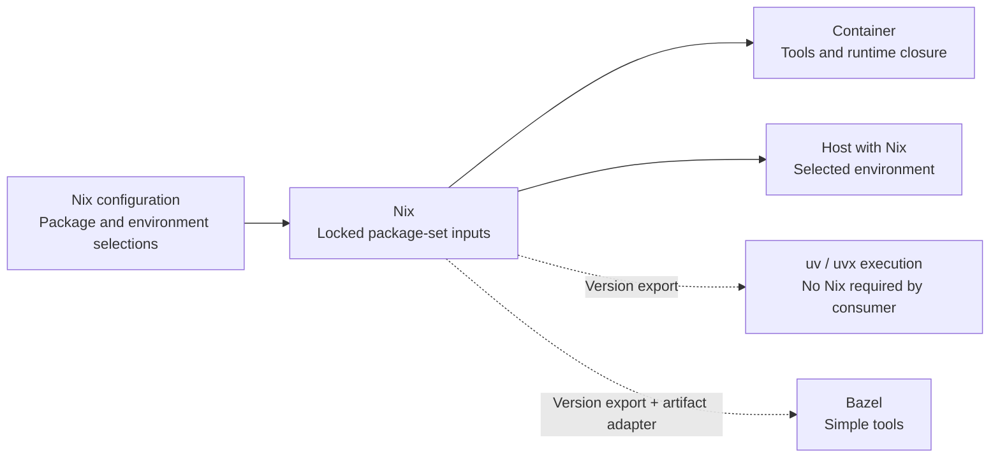

<!--
*******************************************************************************
Copyright (c) 2026 Contributors to the Eclipse Foundation

See the NOTICE file(s) distributed with this work for additional
information regarding copyright ownership.

This program and the accompanying materials are made available under the
terms of the Apache License Version 2.0 which is available at
https://www.apache.org/licenses/LICENSE-2.0

SPDX-FileCopyrightText: 2026 Contributors to the Eclipse Foundation
SPDX-License-Identifier: Apache-2.0
*******************************************************************************
-->

# Decision record: Tool provisioning and version ownership

- **Status:** Decided: consolidate own provisioning; upstream implementation remains pending.
- **Date:** 2026-10-30.
- **Updated:** 2026-11-02, including maintained own provisioning, fresh amd64 integration and ARM64 prepared execution.
- **Scope:** Tool management in this repository, including the use case in
  [#189](https://github.com/eclipse-score/devcontainer/issues/189) and the
  restructuring discussed in [#190](https://github.com/eclipse-score/devcontainer/issues/190).

## Recorded decision and scope correction

The [current four-option comparison](tooling-direct-comparison.md) supersedes
older recommendations below. The [own implementation](tooling-own-provisioning.md)
now has maintained release/update, full amd64 build and ARM64 prepared execution
evidence. Parent review independently reran its 45 unit tests, prepared-runtime
checks and source/evidence validation. We choose consolidated own
provisioning for the confirmed scope: it reuses portable Bazel definitions
without introducing another manager or owner-to-Bazel translation. The external-manager
alternatives do not provide sufficient demonstrated benefit for the current
scope. The own implementation is the working target; other variants remain
evaluation evidence rather than maintained production alternatives.

Where a design choice can follow patterns and conventions similar to Aqua/mise
without additional implementation or maintenance effort, prefer that direction.
Examples are clear declarative tool definitions, explicit version/asset data and
separation of definitions from installation. This is a design preference within
the agreed scope; it adds no schema, adapter or feature requirements. Existing
uv, Bazel and OS package managers retain their roles.

Complexity review distinguishes the shared duties, the complexity of the
finished solution and the one-time migration delta. Existing custom code is
unfamiliar to most contributors and receives no familiarity discount. The
own decision rests on direct artifact reuse and one shared engine,
not on avoiding learning a new product. The exercised own/mise/Aqua version
changes have equal ratings; the earlier own penalty and learning row were
insufficiently justified and are corrected in the live comparison.

Removing a tool means removing it from new Python metadata, Bazel offerings and
new images. Automatic cleanup of existing developer installations, ownership
ledgers and profile reconciliation are not requirements. Earlier comparisons
of those mechanisms describe optional prototype capabilities, not adoption gates.
Full ARM64 image, native macOS validation, artifact distribution and upstream
review remain open. The historical exploration below records how the evidence
developed; it must not override this corrected scope or current status.

## 1. What we want to decide

How should we define the tools we provide, maintain their versions, and make
those tools available to the workflows we actually need to support?

The desired outcome is straightforward: maintainers have an understandable place
to add, update, and remove tools; consumers get the intended versions without
maintaining duplicate pins. We should prefer an established solution when it
makes this easier. A custom catalog is an option to justify, not the starting
assumption.

This record combines confirmed requirements from the discussion on 2026-10-30
with explicitly marked proposals. Multiple backend configurations are acceptable;
we describe direct dependencies, require matching tool versions, and aim to
support macOS on ARM where feasible. Bazel CLI delivery is limited to simple self-contained tools and lightweight
Python delivery; complex tool packaging is excluded. Native uv/uvx execution and dependency consumption are required for the Python consumer; the
producer-side choice is now consolidated own provisioning.

## 2. What is already known, and where it comes from

Different kinds of evidence carry different weight:

| Evidence | What it establishes | What it does not establish |
| --- | --- | --- |
| Direction confirmed in this discussion | Simpler maintenance; multiple configs in one folder are acceptable; normally describe direct dependencies only; equal tool versions suffice; support macOS ARM where feasible | A universal schema, full transitive dependency descriptions, or a particular manager |
| #189, **Use case** | A concrete request to select a DevContainer release and use its Python CLI versions in lightweight CI/local workflows without Container or Bazel; pre-commit drift is the example | Approval of every detail in the issue's proposed solution |
| #190 | Requested continuity of container/Bazel delivery and a truthful pinned-execution contract | That its implementation steps remain the best architecture after this review |
| Accepted upstream decision records | Existing S-CORE constraints and architecture context, summarized below | That this repository must implement every infrastructure responsibility itself |
| [Baseline inventory](tooling-status-quo.md) | What the old setup contains and how it is wired | That every tool, path, flag, or installation mechanism is required |
| [Local reference and validation](tooling-reference-implementation.md) | One implementation can satisfy the previously written experiment criteria | That those criteria are the right product requirements, or that this implementation is the simplest solution |

### Existing S-CORE decisions

The following sources were read on 2026-10-30. The published DR-001 and DR-003
pages were also checked against this record. All three decisions are marked
accepted:

- [DR-001: External development tools](https://eclipse-score.github.io/score/main/design_decisions/infrastructure/DR-001-infra.html)
  makes the DevContainer the primary tool distribution, calls for consistent
  versions, pinned artifacts and an offline/retention path, and explicitly values
  simplicity. Its conclusion prefers native installs for small/fast CI jobs,
  especially where version pinning matters less. Bazel aspects remain appropriate
  for configuration-dependent or cacheable analysis; Multitool is an alternative
  whose maintenance the decision describes as currently infeasible for S-CORE.
  This is not a requirement to distribute every CLI through Bazel.
- [DR-003: DevContainer strategy](https://eclipse-score.github.io/score/main/design_decisions/infrastructure/DR-003-infra.html)
  selects a shared base for development and CI, with optional Dev Container
  features for specialized needs. Ordinary startup should use preinstalled
  tools. It does not prescribe our catalog format or require every tool to
  have a Bazel delivery path.
- [DR-001 extension: Build execution contract](https://github.com/eclipse-score/score/blob/main/docs/design_decisions/infrastructure/DR-001-infra-extension.md)
  adds explicit build contracts: the container is the default, compatible native
  environments are permitted, and compatibility concerns build-relevant
  properties rather than byte-identical environments. Build-relevant tool
  versions must remain reviewable; the container cannot be their only record.

These decisions constrain the discussion. Their application to each tool and
workflow still needs to be made explicit. In particular, release build archival,
Bazel action inputs, container reproducibility, and running a lightweight Python
CLI are related responsibilities, not automatically identical requirements.
A proposal that changes an accepted upstream decision must identify that change.

Consequences for this refactor:

- Keep container-first delivery and direct IDE executable access. The bounded
  Bazel CLI adapter is compatibility work, not a universal delivery requirement.
- #189 fits the native/lightweight workflow direction; its lightweight consumer must support direct uv/uvx invocation and standard
  dependency resolution; a custom runner may be optional convenience.
  Release metadata retrieval and the final documented command remain to be designed. Do not claim automatic conformance with every DR-001
  reproducibility requirement merely because that workflow is permitted.
- Equal tool versions are the confirmed version-alignment guarantee here.
  DR-001 also requires hash-pinned artifacts, no hidden execution-time fetching
  and an offline/retention path. These remain separate acceptance concerns.
  An initial online install is distinct from prepared offline execution; a
  launcher that may resolve/download dependencies on every run has not yet
  demonstrated that execution contract.
- The choice of package manager must preserve the shared container base and
  feature model. Central tool configuration is another DR-001 concern; selecting
  versions does not by itself solve sharing tool configuration across repositories.

## 3. Proposed requirements baseline

### The outcome in seven requirements

The confirmed scope decisions below constrain these proposed requirements.
Details not addressed by the user remain proposals, rather than descriptions of
the local reference's implementation.

| ID | Proposed requirement | Evidence and confidence |
| --- | --- | --- |
| R1 | A maintainer changes a deliberately managed tool version once. Each delivery path derives its selection from that owner; downstream repositories select a release rather than copy individual pins. | Discussion, #189 and #190; high |
| R2 | Keep the published DevContainer as the standard development environment, including direct CLI/IDE access as the non-root development user. Retain existing simple Bazel interfaces; exclude complex tool packaging from Bazel CLI delivery; provide a lightweight path for selected Python CLIs without Container or Bazel. That path must support uv and uvx directly and resolver-visible package dependencies; a project-specific runner is optional convenience. | Upstream decisions, baseline documentation, #189 and #190; high for workflows, implementation open |
| R3 | A shared tool has the same declared release version across its supported delivery paths. Record exceptions explicitly; do not silently substitute a convenient host version. | #189's pre-commit mismatch and #190; version-level guarantee confirmed in the discussion; full dependency locking is not required here |
| R4 | `run-tool` trusts the tools installed in the selected S-CORE container, including in strict mode. Outside the container, default convenience mode may use PATH; `--strict` selects the release-pinned delivery path instead. Preserve arguments, working directory and exit status. | User-confirmed container trust boundary; refines #190's stronger per-invocation verification wording |
| R5 | Adding/removing a tool declares its intended environments and delivery availability once. Derived registration, metadata and documentation may use multiple files but must not require manual synchronization of repeated selections or pins. | Discussion and #190; avoiding drift and allowing multiple configuration formats confirmed in the discussion |
| R6 | Maintainers can understand an ordinary update and its affected consumers. Prefer an established package/tool model when it reduces custom maintenance; compare ecosystem activity and team familiarity as well as technical fit. | Discussion and upstream simplicity goals; high for goal, team familiarity not established |
| R7 | Separate provisioning from execution for every tool. Provide direct execution after installation; no mandatory slow wrapper, per-call resolution, synchronization, Bazel analysis or network checks. Thin forwarding adapters are allowed. Compare provisioning cost separately from repeated startup overhead. | User-confirmed on 2026-11-01; measurements pending |

### Working defaults for scope and guarantees

Confirmed rows reflect the user's clarification on 2026-10-30. Other rows remain
working proposals; none is inferred as a requirement merely from an old script.

| Topic | Proposed default | Basis and limitation |
| --- | --- | --- |
| Tool scope and authoring | Describe deliberately selected direct dependencies and environment membership. Multiple backend-native configs in one understandable folder are acceptable; there is no requirement for one schema or universal installer. Resolvers may generate transitive locks without requiring us to describe each transitive package by hand. | **Confirmed.** Exact folder layout is an implementation choice. Direct dependencies include intentionally requested OS/runtime packages, not just standalone CLIs. |
| Distribution | Container is the default; Bazel CLI delivery covers simple self-contained tools, with Python delivery only where a lightweight shared adapter suffices. Complex tools need no Bazel delivery path. A lightweight path starts with pre-commit; direct uv/uvx execution and normal package-dependency consumption are required; an optional runner is allowed. Do not require every tool on every delivery path. | #189 and #190. Bazel delivery boundary confirmed by the user. Preserve existing simple interfaces; U5 requires native uv/uvx consumption and resolver-visible tool dependencies. |
| Version consistency | The same declared tool versions across supported delivery paths suffice. Platform-specific artifacts are allowed; tools must run with their required runtime/ABI. Do not require identical transitive dependency or interpreter environments for this change. | **Confirmed.** Existing build archival/provenance obligations still apply in their own scope; equal CLI versions do not claim fully identical environments. |
| Container platforms | Preserve Linux amd64 and arm64 image builds, with explicit per-tool exceptions such as CodeQL's current amd64-only delivery. | Both are in baseline CI. Full downstream build tests currently run only on amd64; arm64 image support does not establish complete downstream support. |
| Host platforms | Support Linux host workflows and target macOS on ARM for applicable host tools as far as feasible. Compare candidates for this use; document per-tool exceptions and validation gaps. Do not require Linux-only tools to become portable. No new Windows or Intel macOS promise. | **macOS ARM direction confirmed.** Existing native metadata includes macOS ARM artifacts. Actual macOS execution remains unvalidated here; define a representative check and record unavailable tools before claiming coverage. |
| Environment selection | Support the published S-CORE environment and this repository's build/test environment. Preserve existing feature composition during migration. Add tool groups only for a demonstrated consumer. | Two distinct environments are documented today. No evidence yet for a general matrix of arbitrary user profiles. |
| Release selection | One repository release identifies the related image and tool definitions; use immutable references for reproducibility-sensitive use. Consumers need not copy each tool's version. | #189 and upstream provenance requirements. A release label identifies related outputs; it does not make independently resolved dependencies identical. |
| Offline and archival | Keep the existing container/build archival contract. This repo supplies immutable references and metadata for the artifacts it owns; deployment/release infrastructure must retain the required artifacts. Standalone installation may fetch initially and must document its resolution/cache limits. | Upstream contracts apply. A fully offline standalone execution guarantee requires a defined prefetch procedure and ownership; that work is not proven complete by version alignment. |
| Updates | Review CLI version changes centrally. Keep OS security updates in their OS backend; an already published immutable image remains unchanged. Refresh locks/artifact hashes where the selected backend supports them. | Proposed separation of tool updates, image construction and historical image retention. Existing APT prefixes are not themselves a requirement. |
| Migration compatibility | Preserve documented command names/Bazel labels and argument/cwd/exit behavior initially. Treat internal paths and scripts as replaceable unless a caller is found. Changed public behavior needs an explicit migration path. | Baseline tools documentation presents a downstream interface. Preservation is a conservative migration constraint, not a permanent endorsement of its implementation (U3). |

A shared Python CLI is not a consumer project's Python dependency environment.
Likewise, pinning pre-commit itself does not centrally own the consuming
repository's hook revisions or every environment those hooks create.

### Concrete consumers and success scenarios

Evidence below comes from the baseline at
`0cc738794384cf32f08ba616c049bf8f3fb7124c`, the current files where noted, and the
issue use cases. A documented interface is evidence of intended use, not proof
that all downstream consumers have been enumerated.

| Scenario and consumer | Proposed interface and platform | Required guarantee and success criterion | Evidence |
| --- | --- | --- | --- |
| S1: Module developer runs a formatter/linter; IDE runs its language server | Direct installed CLI in the published image, as the development user; Linux amd64/arm64 where the tool is supported | Command works without first installing tools at container startup. Shared tool version matches the release definition. IDE can use an executable path. | [Main usage guide](../README.md), [baseline inventory](tooling-status-quo.md), upstream decisions |
| S2: Lightweight CI checks a consuming repository | Release-selected pre-commit without Bazel/Container; Linux amd64, native uv/uvx consumption | Resolves the centrally selected pre-commit version; passes arguments, cwd and exit status correctly. Consumer maintains its release reference and hook config, not another pre-commit pin. Supply release-selected dependencies uv/uvx can resolve natively; an optional runner cannot be the only access path. No candidate manager is required on this consumer. | #189's use case; the reported shared-workflow command has not been independently audited here |
| S3: Existing Bazel consumer runs a shared CLI | `bazel run @score_devcontainer//tools:ruff -- ...` or existing pre-commit target; preserve platforms with existing artifacts | Uses that module release's tool definition; no new host Python prerequisite; preserves caller cwd and exit status. New internals must not silently break existing labels. | [Baseline tool guide](https://github.com/eclipse-score/devcontainer/blob/0cc738794384cf32f08ba616c049bf8f3fb7124c/tools/README.md), #190 |
| S4: Maintainer updates or adds a shared CLI | Repository-owned definition and environment selection; validate intended delivery paths | One maintained version decision, generated/resolved outputs may change. Selected paths and documentation agree automatically; a missing registration fails validation. | #190 and the duplication recorded in the baseline inventory |
| S5: Container maintainer builds and tests this repository | Separate repository development environment plus image build/test scripts; Linux amd64/arm64 | Build/test tooling is available without forcing it into the published consumer image. Existing image checks remain runnable. | [CI](../.github/workflows/ci.yaml), [architecture overview](README.md) |
| S6: Developer runs shared tools on Apple Silicon | Release-selected ruff and pre-commit in a native macOS ARM checkout, using the selected host delivery interface | Aim for the same declared versions as the release and preserved cwd/arguments/exit status. Document upstream platform gaps; no claim of current macOS validation. | User-confirmed target; native macOS ARM artifacts exist; end-to-end check still needed |

Representative image consumers already named in baseline CI are
`eclipse-score/score` and `eclipse-score/inc_someip_gateway`. CI invokes
[`scripts/test_consumer.sh`](../scripts/test_consumer.sh) on amd64, conditionally
for PRs. That is evidence of image consumers, not evidence that these repositories
use every public Bazel label or wrapper; their call sites have not been audited.

### Execution and container trust

Provisioning and execution are separate: an installed tool must have a direct
execution path without mandatory per-call resolution, synchronization, build
analysis or network checks. Thin forwarding adapters remain acceptable. This
applies to all tools and delivery paths, not only uvx. Existing Bazel entrypoints
remain supported, with a direct path for ordinary execution.

The [execution-path decision and comparison](tooling-execution-paths.md) records
this confirmed requirement, the unchanged convenience/strict modes and container
trust boundary, and the pending measurements. Functional checks alone do not
prove acceptable startup overhead.

### Clarifications confirmed on 2026-10-30

- **U1 resolved:** Multiple configs in one folder are acceptable. Normally
  describe direct dependencies only; no unified schema or hand-maintained
  transitive package inventory is required.
- **U2 resolved:** Matching tool versions are sufficient for this change.
- **U4 narrowed:** macOS on ARM is a desired host platform with reasonable
  per-tool limits. Validation coverage and exceptions remain to be established.

### Bazel: confirmed delivery boundary

**Decision:** Do not package complex tools for Bazel CLI delivery. The intended
scope is readily distributable self-contained executables, typically static
binaries. Python CLIs may also be exposed where a lightweight shared launcher
suffices, as in the current reference. If a tool needs bespoke runtime assembly,
OS dependency provisioning or a substantial packaging adapter, omit its Bazel
delivery path and document the supported alternatives.

This is the project's maintenance boundary, not a claim that Bazel or
`rules_multitool` technically cannot distribute other kinds of executable.
It does not require removing an existing working tool merely because its binary
uses the supported platform's runtime libraries. Bazel build/toolchain
integration remains a separate responsibility.

### Bazel: where the extra work comes from

The discussion raised an official Bazel baseline. The published decisions give
that a narrower meaning: DR-001 retains aspects for suitable build-aware analysis
but does not mandate Multitool delivery for independent CLIs. DR-003 requires
Bazel compatibility, not universal CLI packaging. Existing Bazel interfaces in
this repository and #190 are migration commitments to assess separately.

The build system and independent CLI distribution are separate responsibilities.
Existing public-interface changes need a consumer review and explicit migration
proposal. New complex tools are outside Bazel CLI delivery by default; they need
no elaborate adapter to satisfy these decisions.

The assessment below is based on code structure, not measured engineer-hours.

| Area | Observed additional work | Proposed treatment |
| --- | --- | --- |
| Existing native CLI delivery | [`MODULE.bazel`](../MODULE.bazel) registers 10 native lockfile hubs; [`tools/BUILD.bazel`](../tools/BUILD.bazel) separately lists 11 command aliases. The [shared validator](../tools/score_tools/catalog.py) checks that those lists match the catalog. Ordinary version changes still use the existing lockfile owner. | Low incremental burden while the current artifact format remains. Keep initially; derive registrations if justified. This repetition alone does not justify removing Bazel. |
| Python CLI delivery | [`python_tool.bzl`](../tools/python_tool.bzl) loads Starlark metadata and constructs a pinned uvx launcher; the [shell adapter](../tools/internal/run_python_tool.sh) handles Bazel-relative paths and caller cwd. Dedicated tests cover this boundary. Adding another Python tool already derives its target from the catalog. | A real adapter and test surface, but not a separate implementation per tool. Do not require the future primary config to remain Starlark just for this consumer; evaluate a generated adapter against actual downstream use. |
| Adopting a different tool manager | Conditional cost: if its definitions cannot directly supply existing Bazel targets, we need an export/generation step, metadata mapping and synchronization checks. A manager-driven execution path may also introduce a host bootstrap requirement. | Compare the concrete bridge for shortlisted candidates. Reject duplicate hand-maintained pins. Keep any bridge limited to simple supported tools. Do not build a substantial packaging subsystem to extend Bazel coverage; propose a migration if an existing public interface is affected. |
| Promising every tool through Bazel | Conditional cost: OS dependencies, services and complex runtime layouts would need additional packaging/adapters. The current baseline does not expose every container tool this way. | **Excluded by the confirmed scope.** Provide such tools through the container or another suitable delivery path; no Bazel packaging work is required. |
| Build-integrated tools and toolchains | These participate in action inputs, toolchain selection and cache correctness, beyond interactive CLI invocation. | Preserve this responsibility. Reassessing independent CLI distribution does not authorize removing build integration. |

Current evidence does **not** show that Bazel already causes disproportionate
maintenance for simple native tools. The largest possible extra cost is a new
cross-manager bridge, especially if we insist on extending it to every tool.
Limit any bridge to the confirmed simple-tool scope. Review users before
changing existing entrypoints; new complex tools do not enter that scope.

### Remaining decisions for review

| ID | Working recommendation | Remaining uncertainty and next evidence |
| --- | --- | --- |
| U5 — native uv/uvx consumption | **Confirmed:** uv and uvx can invoke the selected tool directly, and uv projects can depend normally on the S-CORE-selected tool version (e.g. Ruff). A `score-tool` command is allowed as optional convenience. | The bounded package/dependency/uvx path is verified for all three candidates; choose production naming, distribution and release integration. |

U3 is resolved as a scope boundary: complex tools have no Bazel CLI delivery
requirement. The remaining implementation question is how cheaply to retain
simple existing interfaces under the selected manager. U5 is resolved below. No
manager is selected and no consumer interface is removed or published by this
record.

### U5 confirmed: native uv and uvx consumption

The consumer must be able to use **uv and uvx directly** with the tool versions
selected by a S-CORE release. A `score-tool pre-commit` convenience command is
allowed, but must not be the only way to obtain the centrally selected tool.
The essential requirement is ordinary dependency resolution, not a ban on every
wrapper command.

In particular, a uv-managed project must be able to depend on the S-CORE-selected
Ruff version through normal package metadata, without copying the Ruff version
pin. uv/uvx must also be able to install and invoke the actual tool using the
release selection. They must not need to execute our custom runner first to
discover a pin or install a second tool environment hidden from their resolver.
No Container, Bazel, mise, aqua or Nix installation is required on this consumer.
The existing `run-tool` contract for other delivery paths is unchanged.

One possible package model is a release-selected tool bundle with optional
per-tool dependencies (for example a Ruff extra), whose standard dependency
metadata requests the authoritative `ruff==...` version. The actual `ruff`
entrypoint is then supplied by Ruff's distribution. Separate per-tool packages
are another option; package names, extras and Git/artifact distribution are not
yet selected. This is a packaging design option, not an existing published API.

Use standard Python [dependency and optional-dependency metadata](https://packaging.python.org/en/latest/specifications/pyproject-toml/)
that [uv can resolve](https://docs.astral.sh/uv/concepts/projects/dependencies/).
Derive it from the authoritative tool definitions if needed; do not introduce
another hand-maintained pin owner. A requirements export remains useful for
native uv execution, but by itself does not prove the requested reusable package
dependency contract. The subsequent [version-maintenance comparison](tooling-version-workflow-comparison.md)
verified ordinary package dependencies, consumer locks, installed metadata and
actual uv/uvx execution for two releases of each candidate. Production naming
and release distribution remain to implement.

This applies to tools available through suitable Python distributions, including
Ruff even though the existing catalog distributes it as a native executable.
It does not require packaging every OS/native tool for Python or Bazel. Keep the
confirmed same-tool-version guarantee; identical artifact/transitive environments
are not newly required.

Consequences for all candidates: provide resolver-visible release metadata for
the selected tools. An optional runner is additional convenience, not the
version authority or a prerequisite for normal uv/uvx consumption.

## 4. Existing behavior is evidence to investigate

The baseline inventory and reference remain useful migration evidence. They
should not silently determine the selection criteria for a new tool manager.

| Existing mechanism | Underlying need to investigate | Treatment until clarified |
| --- | --- | --- |
| APT version prefixes and distribution-managed packages | Compatibility, security updates, or simply the available packaging | Do not require a new manager to reproduce these exact policies by default |
| Per-package APT flags and temporary build dependencies | Runtime dependency needs versus image construction details | Keep as installation observations; require a user-facing reason before making them selection criteria |
| CodeQL pruning and extra setup | Required functionality, image size and startup behavior | Identify required commands/workflows; do not assume the current pruning script is the contract |
| Java installation paths and wrapper layout | Tools can find their runtime; consumers may rely on paths | Verify callers before promising exact paths |
| Separate native, Python, feature and OS metadata | Backend requirements versus avoidable duplication | Judge independent authoring decisions, not the count of generated or backend-specific files |
| Existing Bazel aliases and `run-tool` | Downstream invocation compatibility | Find consumers and classify interfaces before removing or freezing them |

Unknown does not mean unnecessary. A behavior may need to remain during migration
without becoming a permanent architectural requirement. Record such a constraint
with its consumer and eventual removal condition.

## 5. Research available for the eventual choice

The table retains the broader research shortlist. The completed mise, aqua and
Nix probes, initial hypothesis and subsequent direct comparison follow below. Popularity is a
maintenance/adoption signal, not proof of suitability.

| Candidate | Why it remains relevant | Main question for our scope |
| --- | --- | --- |
| [mise](https://mise.jdx.dev/dev-tools/backend_architecture) | Broad developer tool manager with multiple backends and Python CLI support | Can ordinary tool/version/environment maintenance use its conventions directly, with little repository-specific glue? |
| [aqua](https://aquaproj.github.io/docs/reference/registry-config/) | Declarative CLI artifact recipes and an existing registry | Does our required scope fit downloaded CLIs, or would Python/OS provisioning leave substantial parallel ownership? |
| [Nix](https://nix.dev/tutorials/first-steps/declarative-shell.html) | A package/environment model that also covers libraries and dependencies | Does adopting its ecosystem simplify our real requirements enough to justify the learning and integration cost? |
| [Pixi](https://pixi.prefix.dev/latest/reference/pixi_manifest/) | Conda/PyPI packages, environment composition and locks | Are the tools and versions we actually need available in that ecosystem? |
| [Devbox](https://www.jetify.com/docs/devbox/configuration) / [devenv](https://devenv.sh/packages/) | More convenient workflows on top of Nix | Can they reduce the team-facing cost without hiding integration work we still have to maintain? |
| [Ansible](https://docs.ansible.com/projects/ansible/latest/collections/ansible/builtin/apt_module.html) / [Hermit](https://cashapp.github.io/hermit/packaging/reference/) | Established provisioning modules or a portable tool packaging model | Would either remove more custom maintenance than it introduces for the selected delivery paths? |
| [Current local reference](tooling-reference-implementation.md) | Working comparison point using existing backend formats and shared metadata | Is the custom model necessary, and is it actually simpler than the alternatives? |

### High-level architecture alternatives

These diagrams show possible target architectures, not adopted implementations.
In all three variants, OS packages and specialized installation steps may retain
APT and Dev Container feature configuration. Bazel delivery is limited to simple
tools; no complex-tool packaging framework is implied. Dashed edges identify
additional export/adapter work. The Python consumer supports native uv/uvx execution and dependency resolution
(U5). Dashed Python exports represent release metadata; an optional convenience
runner is not a prerequisite.

#### mise: shared orchestration for native and Python tools

Native and Python tools follow mise configuration conventions. mise orchestrates
installation and executable discovery through its backends. Existing Bazel
interfaces and a uv-only release interface still need bounded integration.

#### aqua plus uv: two specialized backends

aqua supplies downloadable native programs; uv supplies Python tools. Their native
configurations can live in the same directory. Container preparation combines the
two workflows; existing Bazel and public release interfaces retain integration
work. No shared universal schema is required.

#### Nix: packages together with their required runtime

Nix provides packages with their required libraries and interpreters. Container
provisioning retains that runtime closure. A uv-only consumer can use exported
versions without installing Nix; portable Bazel delivery additionally needs
upstream binary artifact metadata. Neither export is the same as copying an
arbitrary Nix executable out of its runtime.

### Local candidate experiments

Recorded on 2026-10-31 from the three reports dated 2026-10-30. Three agents
worked in separate worktrees from reference commit
`2e337e41fba86ea7a94ee3d5e58cf3c4f7d93561`, each with the same decision-record
snapshot (SHA256 prefix `47b2f925a4d97450`). They used the confirmed requirements,
not the historical reference implementation as a mandatory architecture.

| Candidate | Local branch and sibling worktree | Report within that worktree |
| --- | --- | --- |
| mise | `eval/tool-manager-mise`, `score_devcontainer-eval-mise` | `experiments/tool-manager-mise/README.md` |
| aqua | `eval/tool-manager-aqua`, `score_devcontainer-eval-aqua` | `experiments/tool-manager-aqua/README.md` |
| Nix | `eval/tool-manager-nix`, `score_devcontainer-eval-nix` | `experiments/tool-manager-nix/README.md` |

These are local, uncommitted experiment artifacts, not published branch links.
The reports contain commands, configurations, primary-source references and
limitations. Preserve the relevant artifacts before discarding the worktrees.
The summary here is self-contained so the conclusions do not depend solely on
those temporary worktree paths.

The shared probe covered a native CLI (Ruff), a Python CLI (pre-commit), ordinary
version/selection changes, host/container delivery implications and bounded
compatibility with existing Bazel delivery. All three ran on Linux x86_64. Each
ran Ruff on an unused-import fixture with the expected diagnostic and exit 1,
and pre-commit with a local system hook successfully. These checks establish
basic functionality, not full tool parity or arbitrary downstream hook support.

| Candidate | Actual manager/tool versions | Maintainer-owned inputs | Principal observed result |
| --- | --- | --- | --- |
| mise | mise 2026.10.24; Ruff 0.11.13; pre-commit 4.7.0; uv 0.13.6 | Native TOML configurations, generated native lock; repository overlay adds ShellCheck 0.10.0 | Installs and executes both tool types using built-in backends. Ruff update 0.11.13 → 0.11.12 → 0.11.13 and environment selection exercised. |
| aqua | aqua 2.65.2; Ruff 0.11.13; pre-commit 4.7.0; uv 0.11.2 | Native YAML with pinned registry, Python `requirements.txt`, generated checksums | Native binaries exported with `aqua cp`; Python runs through uv. Ruff 0.11.12 and pre-commit 4.5.1 exercised in temporary update copies. |
| Nix | Nix 2.35.4; Ruff 0.17.2; pre-commit 4.7.0 | Native flake selecting direct packages/environments; generated package-set lock | Tools and environment selections work in isolated official Nix container; add/remove exercised. Package-set refresh command succeeded but selected the same revision, so no actual version change is claimed. |

Nix used locked Nixpkgs revision
`1c89083e451e891152365b799595cf7790a43325`. Its Ruff version differs intentionally:
using the ordinary packaged version avoided building a custom recipe solely to
match a historical pin. aqua's older uv version was a deliberate bootstrap
choice, not a registry limitation or a proposed production downgrade. No timing,
image-size or installer-code line count is treated as a controlled benchmark.

#### mise findings

- Normal install/exec works from direct tool versions without a manually pinned
  Python runtime or handwritten transitive dependency graph.
- A common lock can cause current mise to generate Python dependency sidecars,
  including during later installs. The final probe separates
  `mise.native.toml`/`mise.native.lock` from unlocked `mise.python.toml` and uses
  the native environment mechanism to combine them. A fresh isolated install
  confirmed native hash locks plus version-only Python delivery without a
  managed interpreter pin or sidecars. Multiple files are acceptable here.
- A 54-line export prototype, including comments, derives native Bazel metadata
  and the existing Python catalog shape. Ruff version, URL, hash, platform and
  extraction path matched the existing catalog for Linux x64/ARM64 and macOS
  ARM64. Bazel was **not** rebuilt from this export; metadata equivalence is the
  tested result. The exporter still owns Ruff-specific archive-layout knowledge.
- Installed executables ran directly without invoking mise. This supports
  preinstallation in the container, but does not prove non-root permissions,
  stable venv/runtime paths or full image integration.

#### aqua findings

- aqua handles native CLI artifacts; uv plus a normal direct-requirements file
  covers Python. This is compatible with the agreed multiple-config boundary;
  lack of a built-in PyPI backend is not itself a rejection criterion.
- `aqua cp --tags ...` produced directly executable selected binaries suitable
  for image provisioning. `aqua install --tags ...` alone is not an availability
  boundary: it creates proxies for other configured tools, which may lazy-install.
- Native checksum enforcement was explicitly enabled. Ruff's registry recipe
  selects Linux musl artifacts rather than the old GNU artifacts; versions match,
  while artifact identity is not required by the confirmed scope.
- A 56-line Ruff-specific exporter, including comments, generated Multitool
  metadata. A separate minimal Bazel 8.6.0 / rules_multitool 1.11.1 workspace
  actually executed Ruff 0.11.13 from that output. The generator used Python;
  the Bazel consumer did not require Python or aqua. Python Bazel metadata
  integration from the new requirements file was not implemented/tested.
- Python also ran from a prepared fixed venv. A prepared uv-cache invocation
  passed with offline mode enabled; that is narrower than a network-denied
  execution test or a complete offline environment guarantee.

#### Nix findings

- Native package selections and environment composition need no custom installer
  or Python resolver. Updating the locked package set may update several tools;
  independent version selection may need another input or an override/recipe.
- The experiment used an isolated official container rather than installing Nix
  globally. The same functionality checks passed after disconnecting its network,
  demonstrating prepared offline execution for this small selection.
- Merely copying the Nixpkgs Ruff executable onto the Ubuntu host failed: its ELF
  interpreter and a library refer to the Nix store. That is a property of the
  tested package, not a claim that upstream Ruff cannot be distributed statically.
  Image integration must preserve the runtime closure; native `nix run` requires
  Nix on the host. No full Ubuntu/feature-image integration was built.
- Native `nix eval` exported version JSON. The exported pre-commit version was
  successfully used by host uvx without host Nix. For portable Bazel Ruff delivery,
  a similar version export would still need upstream asset names, extraction
  layout and binary hashes; the Nix source hash is not a release-binary hash.
  That delivery path was not implemented, and complex Nix packages need no Bazel
  packaging under our confirmed boundary.

#### Shared limitations and remaining integrations

macOS ARM was checked through artifacts, package evaluation or Python resolution;
none of the experiments ran on an actual Mac. Linux ARM execution, production
image builds, non-root image execution and complete tool coverage were also not
validated in these probes. Nixpkgs may patch packages and aqua/mise may choose
different platform builds; version equality does not establish identical behavior.

All candidates retain integration work for existing simple Bazel interfaces.
The demonstrated Ruff exporters are bounded examples, not general converters:
versions/hashes alone do not describe every archive layout, alias or auxiliary
file. Do not expand them into a complex-tool packaging framework. Their line
counts show the scale of these examples, not the final migration cost.

For #189, U5 requires native uv/uvx execution and ordinary resolver-visible
package dependencies for release-selected tools. The earlier requirements routes
were partial evidence; the later version-maintenance comparison verifies the
ordinary package/dependency/uvx route for the bounded Ruff case. A
`score-tool` convenience command is allowed, but cannot be the only way to
obtain/invoke a selected tool. Package metadata and release distribution still
need design and a focused check.

Container execution continues to trust preinstalled pins in both `run-tool`
modes. Host strict execution must select the release/config deliberately,
preserve the caller's cwd and avoid accidental PATH/config fallback. Generic
manager invocation or the experimental harness is not yet a production runner.

Prepared cache/direct execution is not proof of ten-year retention. The upstream
hash, prefetch, offline and archive requirements need explicit integration and
acceptance evidence regardless of the selected manager.

#### Initial recommendation and current maintenance comparison

The initial mise preference based on a common frontend was not established as
an overall maintenance advantage. See the direct review below and the subsequent
[concrete version-maintenance comparison with criterion ratings](tooling-version-workflow-comparison.md#criteria-and-integration-assessment).

The latter shows the same narrow workflow for all three: one authoritative Ruff
selection feeds native installation, generated Bazel metadata and standard
package dependencies. Actual consumer uv locks/package metadata, `uv run` and
`uvx` match before/after selections without consumer Ruff pins or producer managers.
All three use the same ordinary metapackage/extra mechanism. Native
`uvx --with 'FACADE[ruff] @ RELEASE' ruff` was tested without the warning observed
with the `--from` form; no custom executable wrapper is required.

The concrete comparison separates authored/generated diffs, permanent exporters
and release wiring from throwaway fixtures. mise and aqua retain similar classes
of integration; Nix additionally owns package-set/closure lifecycle. This supports
comparing responsibilities, not a measured migration/maintenance winner. Bazel
metadata was inspected in this round; full images were not rebuilt. Public
release automation and catalog-wide mapping remain implementation work.

#### Direct comparison after mutual review

**The shared follow-up is complete; the first mise preference is not confirmed
as an overall maintenance advantage.** See the
[direct comparison](tooling-direct-comparison.md) for the protocol, evidence,
responsibility table and corrected conclusions. The
[common test protocol](../experiments/tool-manager-comparison/protocol.md) and
its small Ubuntu test-base Dockerfile are retained locally in this repository.

All three agents read each other's reports/configs/adapters, exchanged technical
questions directly, agreed the same three outcome checks, then reviewed the new
reports and relevant evidence against each other. The parent also challenged
whether separately successful baseline/runtime and host-update tests actually
proved update propagation; mise and aqua closed that precise gap with targeted
updated-runtime version checks.

| Agreed check | mise | aqua + uv | Nix with exported uv host metadata |
| --- | --- | --- | --- |
| Independently change one direct tool, retain the other version | Passed | Passed | Passed via a second locked published package-set input, without a custom recipe |
| Run release-selected tools outside the checkout despite conflicting PATH/config; retain cwd, arguments and observed exit codes | Passed with explicit config selection and cwd adapter | Passed with absolute backend config paths and cwd-preserving commands | Passed through generated requirements and actual host uv; native host Nix remains untested |
| Execute complete prepared runtime directly in the same Ubuntu base, uid 12345, no network or runtime manager | Passed with retained installs/venv and system Python | Passed with native binary plus fixed venv and system Python | Passed with complete readonly Nix runtime closure |

The mutual review changed the assessment in several ways:

- mise uses uv and aqua recipes; one frontend is not evidence of less maintained
  code. Its common install/bin discovery is useful, but profile/lock policy and
  release invocation still need ownership.
- aqua plus ordinary uv configuration is a valid small multi-backend approach.
  It need not acquire a universal schema to satisfy our requirements.
- Nix can update one direct tool independently via another locked package input,
  and its complete runtime works in the same Ubuntu/non-root context. The old
  standalone-ELF failure is not a fair basis for rejecting that runtime model.
- All retain bounded Bazel metadata integration. The differing first-round
  proof depths are not ranked as different inherent capabilities.
- The public uv-only interface must be evaluated consistently. Allowing only
  mise to replace that consumer interface would bias the comparison. U5 is now clarified as native uv/uvx execution plus normal package dependencies;
  the later version-maintenance comparison supplies the missing bounded
  package/uvx evidence.

The candidates differ in workflows and responsibilities. The shared milestone
below extends actual delivery code equally before selection. macOS ARM execution,
production image integration, archival and public release UX remain gaps.
Do not infer a winner from success counts, file counts or manager names.

## 6. How this record reaches a decision

1. Apply the confirmed native uv/uvx dependency requirement and evaluate integration costs within the simple-tool
   Bazel boundary, version guarantee and macOS ARM direction in section 3. Record the remaining platform validation gaps.
2. Confirm or revise R1–R6 and the scope defaults. Promote reviewed assumptions
   to requirements; keep migration constraints distinct.
3. Continue all three reference implementations at shared checkpoints, using
   the responsibility table and actual maintenance paths. Add checks for concrete
   integration questions; share improvements and review across candidates.
4. Record the selected approach, alternatives, reasons, consequences and any
   changes needed to upstream decisions here.
5. Derive a migration plan and small reviewable PRs from that decision. Keep
   #189 in the end-to-end validation, and justify any prerequisite work by what
   it enables rather than by its position in the old PR sequence.

The [target design](tooling-target-design.md),
[reference implementation](tooling-reference-implementation.md), and
[PR sequence](tooling-pr-sequence.md) document one explored approach. Their
technical validation remains evidence; their architecture and landing sequence
are conditional on this decision. The completed experiment does not settle the
requirements discussion.

## 7. Decision and consequences

**Requirements partially confirmed; architecture pending.** Multiple backend
configs in a common location are acceptable; normally describe direct
dependencies only. Matching declared tool versions suffice. macOS on ARM is a
host-support target with explicit per-tool exceptions and validation gaps.

Keep the container as default. Limit Bazel CLI delivery to simple self-contained
tools and lightweight Python adapters; complex tools are explicitly outside that
delivery path. Preserve existing simple public entrypoints during migration and
keep Bazel build integration separate. Provide native uv/uvx execution and normal package-dependency consumption;
an optional convenience runner is allowed.

**User direction:** Continue all three candidates equally as local reference
implementations so the comparison remains grounded in working code. The earlier
aqua preference is not the active plan. Retain the comparative assessment as
context, without treating it as a selection decision.

The completed [reference milestone](../experiments/tool-manager-comparison/reference-milestone.md)
established the same checkpoint: Ruff, ShellCheck and pre-commit, two real
environments, release-shaped producer output, standard uv/uvx package consumption,
working simple Bazel targets and prepared non-root Ubuntu runtimes. Candidates
exchange approaches and cross-review. OS/features and complex tools are outside
this bounded milestone; no full legacy image migration is implied.

See the [repository](tooling-repository-milestone.md),
[production](tooling-production-milestone.md) and
[maintenance](tooling-maintenance-milestone.md) comparisons.
See [M8 releases](tooling-release-workflow.md),
[M7 ARM64](tooling-platform-milestone.md) and [M6 integration](tooling-integration-milestone.md).
Earlier evidence covers [installer deletion](tooling-retirement-milestone.md),
[retirement investigation](tooling-installer-retirement.md),
[operational probes](tooling-operations-comparison.md) and
[execution audit](tooling-execution-paths.md). No architecture is adopted;
all work stays local.
