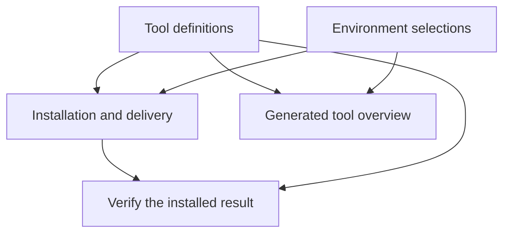

<!--
*******************************************************************************
Copyright (c) 2026 Contributors to the Eclipse Foundation

See the NOTICE file(s) distributed with this work for additional
information regarding copyright ownership.

This program and the accompanying materials are made available under the
terms of the Apache License Version 2.0 which is available at
https://www.apache.org/licenses/LICENSE-2.0

SPDX-FileCopyrightText: 2026 Contributors to the Eclipse Foundation
SPDX-License-Identifier: Apache-2.0
*******************************************************************************
-->

# Proposed tool management architecture

Local discussion draft for #190. The [status quo](tooling-status-quo.md) describes
today's implementation. This document proposes how to organize tool management
across the repository; it does not change existing behavior. The agreed local
implementation scope and completion criteria are in the
[refactoring goal](tooling-refactor-goal.md).

## 1. The goal

**Define each tool once, select where it belongs, and derive installation,
checks, and documentation from those decisions.**

Today, those decisions are spread across version files, installation scripts,
Bazel registrations, tests, and documentation. They can disagree even when each
file looks reasonable on its own.

The goal is to make adding and updating tools predictable, whether a tool comes
from APT, a downloaded release, an external feature, or a Python package. All
explicitly managed tools belong in the overview, including tools available only
inside the container and helpers used only to build it.

## 2. The basic model

Separate three questions:

| Question | Responsibility | Example |
| --- | --- | --- |
| **What is the tool?** | Definition: source, version policy, description, platform support | ShellCheck release and artifact hashes |
| **Where do we need it?** | Composition: which environment or feature includes it | Published image and repository development container |
| **How do we provide it?** | Installation and execution: mechanism, paths, permissions, setup | Download into the image; expose a Bazel target |

The definitions say what to request. Environment selections say where to request
it. Installers apply both. Checks inspect the result against the declared policy,
and the overview makes these decisions visible.

These are responsibilities, not a proposal for a particular directory layout.
Different installation mechanisms can keep the formats they need.

## 3. What changes for maintainers

To **add a tool**:

1. Define its source, version policy, description, and supported platforms.
2. Select the environments and delivery paths that should provide it.
3. Add setup or functional checks that its installation mechanism does not
   already cover.

Installation lists, registrations, and the documented overview follow from those
inputs or are checked against them. Maintainers should not synchronize the same
selection across several handwritten lists.

To **update a tool**, change its authoritative definition and refresh any derived
hashes, resolutions, or documentation. Verify the affected installations. Update
automation follows the same path; it does not maintain a parallel set of pins.

Different environments can select different tools. For example, the container
used to develop this repository needs Docker tooling but does not need every tool
in the published S-CORE image.

## 4. How this applies to existing tools

| Example | Definition | Composition and delivery |
| --- | --- | --- |
| ShellCheck | One native release definition with platform artifacts and hashes | Selected for the relevant containers and exposed through Bazel |
| Git / Git LFS / GitHub CLI | An explicit APT selection policy | Installed in the image; checked against that policy |
| LLVM | Feature reference, feature resolution, and LLVM version option | Selected as a bundle; provided commands appear in the overview |
| CodeQL | Bundle, checksum, supported platforms, and separately versioned packs | Image setup includes paths and environment variables; Linux arm64 omission is visible |
| Bazel | Separate definitions for Bazelisk and the preinstalled Bazel version | Image preinstalls Bazel; a consuming workspace can select its own version |
| Python tools | Package, top-level version, and entrypoint | Container installation and supported host execution reuse the definition |
| `yq` / Dev Containers CLI | Helper definition and version or update policy | Listed as build/development helpers rather than tools shipped in the published image |

The model must work for these different cases before we settle on file formats
or extract shared code. In particular, it must handle both exact downloaded
artifacts and packages resolved from distribution repositories.

## 5. Design rules and technical details

### Version ownership

Each version decision has one authoritative source. A combined catalog can refer
to backend-specific definitions rather than putting everything into one file.
Native artifacts can retain multitool-compatible JSON; APT and external features
can retain appropriate provider-specific metadata.

Related commands can share a definition: `uv` and `uvx`, for example, come from
one release. Distinct decisions stay distinct: an LLVM feature version is not an
LLVM tool version, and a Bazelisk version is not a workspace's Bazel version.

For APT, distinguish the requested constraint from the installed Debian package
version. An unversioned install must be documented as such. Current test-only
YAML values must become either real installation constraints or clearly identified
compatibility expectations, depending on the intended policy for that tool.

### Environment composition

Declare each environment's direct membership once. Installers and the overview
consume that selection; validation catches missing delivery registrations.
Local features can remain boundaries for installation and lifecycle setup.
Mounts, hooks, and configuration need not move into generic tool definitions.

Record platform limitations explicitly. A selected tool that cannot be provided
must fail unless its omission is declared intentional for that platform.

### Installation and execution

Each mechanism controls the installation details it needs: dependencies, paths,
ownership, command exposure, and essential configuration. The development user
must be able to use the result. Installation must not guess that user from the
contents of `/home`.

Tool-specific steps remain possible, such as setting `JAVA_HOME` or downloading
CodeQL packs. We do not need a generic framework that describes every shell
command. Repeated installation policies should be shared where useful.

Tools may be container-only or available through additional paths. There is no
requirement to deliver every tool through Bazel or uv. Existing Bazel execution
must remain usable without host Python.

### Verification and the overview

Checks must inspect the installed result, not merely compare two representations
of the same input. Verify artifact hashes, installed package constraints, command
accessibility as the development user, and necessary functional behavior.

Generate the overview from owned definitions and environment selections. It shows
sources, requested version policies, platform limits, and delivery availability.
Build output can add the versions actually resolved for a particular image.
Requested policy and observed result remain distinguishable.

Generated files may repeat versions; they must not become independently maintained
pins. Checks detect stale generated outputs. Sources without update automation
have a documented manual update path.

### Guarantees and scope

An exact artifact hash, a top-level Python package pin, an APT version prefix, and
a feature digest provide different guarantees. Document these differences rather
than describe all of them as fully locked environments. Some components, such as
the trust store, deliberately follow provider updates.

Full dependency locking, APT snapshots, a formal SBOM, and identical image rebuilds
are separate work. The model should support that work without making it a
prerequisite for every cleanup here.

## 6. Decisions still open

- **Storage:** how to connect the existing backend definitions and environment
  selections without creating another version-bearing registry.
- **APT policy:** which tools need explicit constraints and which intentionally
  follow the distribution; what compatibility checks are independently required.
- **Invocation:** whether users choose direct execution paths or use a common
  dispatcher, and what a pinned invocation guarantees. Arbitrary PATH commands
  cannot be considered verified solely because they run inside a container.

This draft does not decide the future of `run-tool`, its defaults, or its strict
mode. Those decisions follow the execution contract rather than determine the
organization of all tool metadata.

## 7. Implement the complete local target before splitting PRs

Build and validate the complete refactoring locally, including standalone uv
execution from #189. Use the concrete cases above to test the architecture across
providers. Revise the design where those cases expose problems.

Develop the shared foundation and the additional delivery path together. Their
later PRs can follow technical dependencies, with consolidation preceding uv
delivery, but the local reference implementation must prove both before we settle
on that breakdown.

Once the end state works, derive small, independently reviewable PRs that each
leave a working repository and lead to the validated result. Helper extraction
or a Python-only demonstration is not the end goal.

See the [refactoring goal](tooling-refactor-goal.md) for acceptance criteria,
validation expectations, and boundaries. All work remains local; no pushes,
publication, or GitHub issue updates are authorized.
