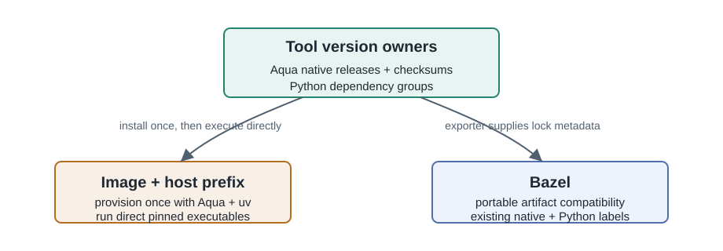

<!--
*******************************************************************************
Copyright (c) 2026 Contributors to the Eclipse Foundation

See the NOTICE file(s) distributed with this work for additional
information regarding copyright ownership.

This program and the accompanying materials are made available under the
terms of the Apache License Version 2.0 which is available at
https://www.apache.org/licenses/LICENSE-2.0

SPDX-FileCopyrightText: 2026 Contributors to the Eclipse Foundation
SPDX-License-Identifier: Apache-2.0
*******************************************************************************
-->

# Maintaining command-line tools

This guide describes how the pinned command-line tools are provided and
maintained. For normal usage, see [Pinned command-line tools](../README.md).

The approach complements the general direction in
[DR-001 Infrastructure Design Decision](https://eclipse-score.github.io/score/main/design_decisions/DR-001-infra.html).

## Delivery contract

One catalog is delivered through two execution paths:

| Component | Responsibility |
| --- | --- |
| `tools/lockfiles/*.lock.json` | Define native tool versions and release artifacts. |
| `MODULE.bazel` | Makes native tool lockfiles available to `rules_multitool`. |
| `tools/BUILD.bazel` | Exposes public Bazel targets for each command. |
| `tools/providers.json` | Define Python and npm packages, APT policies and special setup metadata. |
| `tools/environments.json` | Record the complete tool selection of each existing setup caller. |
| Feature installers | Apply selections and install the commands exposed on the DevContainer's `PATH`. |
| `tools/run-tool` | Uses the command on `PATH` in a container or locally when available; otherwise uses the public Bazel alias (`--strict` forces Bazel). |
| `tools/README.md` | Documents every command and its version from the catalog. |

A command is available when its catalog metadata, Bazel target, and applicable
DevContainer installer are registered together. The runner selects between
those delivery paths; the catalogs remain the command registries.

## Architecture

The public interface is `.devcontainer/run-tool` in each consumer
repository. Inside a container or on the host, it uses the command on `PATH`
when available, or falls back to Bazel (`--strict` forces Bazel). Developers
use the same command line without choosing the execution path.



Native tools with upstream release artifacts use
[`rules_multitool`](https://github.com/bazel-contrib/rules_multitool).

The `multitool_aliases` helper exposes the `rules_multitool` `cwd` target as
the public command. That wrapper restores `BUILD_WORKING_DIRECTORY` before
starting a tool, so configuration discovery and repository-relative paths
behave like a direct invocation.

Python packages do not provide the platform-specific, checksum-addressed
release binaries expected by `rules_multitool`. Their public Bazel targets
therefore use the `uvx` binary from `rules_multitool` to create an isolated
environment for the exact catalogued package version. A shell launcher restores
the caller's working directory before invoking `uvx`; using shell here is
intentional so Python-based tools do not require a system Python installation
on the host.

The DevContainer takes the other delivery path: it installs each Python tool
once with the catalogued `uv` binary and exposes the resulting entrypoint on
`PATH`. Python is already part of the image before feature tools are installed,
so the installer can use its standard library without adding a container or
host dependency.

The maintained runner source is [`run-tool`](../run-tool). It remains under
`tools/` in this implementation repository; consumer repositories copy it to
`.devcontainer/run-tool`. This repository invokes that source directly from
its pre-commit configuration. Consumer documentation only presents the copied
`.devcontainer/run-tool` path.

## Sources of truth

Native tool metadata lives in
[`tools/lockfiles/*.lock.json`](../lockfiles). Each lockfile records versions,
supported platforms, download URLs, checksums, and archive layouts.
`rules_multitool` consumes the files for Bazel. The standard-library-only
[`catalog.py`](catalog.py) reads metadata for
[`devcontainer/install.py`](devcontainer/install.py) and README generation.
The reader also prepares version and checksum variables for setup scripts and
feature tests through `load_setup_metadata()`. It has no installation side
effects; shell quoting, download, platform selection and installation remain in
the container installer.
Other direct packages and special setup are defined in
[`providers.json`](../providers.json): Python package pins, APT constraints,
npm package identities, Bazel preinstallation and CodeQL metadata. The selections reference these names
without copying their versions.

Bazel reads the Python entries from this same JSON file through
[`catalog_repository.bzl`](../catalog_repository.bzl). It creates loadable
Starlark data in Bazel's cache; contributors maintain only `providers.json`.
The container installer reads the JSON directly. `devcontainer-lock.json`
continues to record external Dev Container features, while `uv.lock.json`
records the native installer runtime.

The published `score_devcontainer` Bazel module and DevContainer image share a
release version. Consumers using both must pin the same release.

## DevContainer installation

Each setup caller selects its tools in
[`environments.json`](../environments.json). Definitions contain versions and
installation metadata; selections contain tool names. See the
[DevContainer installer guide](devcontainer/README.md) for selections,
installation phases, permissions and package policies. The scripts in
[`devcontainer/setup/`](devcontainer/setup) explain tool-specific configuration
and their environment-variable inputs beside the implementation.

## Adding or updating a tool

For a tool distributed as a native release artifact, make the following
changes together:

1. Add or update the multitool-compatible
   `tools/lockfiles/<command>.lock.json`, including a `description` field
   for each tool entry.
2. Register the lockfile with `multitool.hub` in the root
   [`MODULE.bazel`](../../MODULE.bazel).
3. Add `multitool_aliases("<command>")` to
   [`tools/BUILD.bazel`](../BUILD.bazel).
4. Add the command to the applicable native selection in
   [`tools/environments.json`](../environments.json): `s-core-local` for the
   `s-core-local` feature or `bazel-feature` for the `bazel-feature` feature.
5. Read expected versions with `install.py shell-metadata` and test the installed
   command in the matching feature test:
   [`s-core-local/tests/test_default.sh`](../../src/s-core-devcontainer/.devcontainer/s-core-local/tests/test_default.sh)
   or
   [`bazel-feature/tests/test_default.sh`](../../src/s-core-devcontainer/.devcontainer/bazel-feature/tests/test_default.sh).
6. If this repository's own DevContainer needs the command, add it to the
   `repository-devcontainer` selection in `tools/environments.json`.

For a Python command-line tool, add its package definition to
[`providers.json`](../providers.json) with `provider: "python"`, its package,
version, entrypoint, description and `requires: ["uv"]`. Add its name to the
`python` group of the applicable selections in `environments.json`. Bazel targets
are created for every Python catalog entry automatically; no second command list
is needed in `BUILD.bazel`. Select native `uv` alongside Python tools for
container installation; Bazel supplies its own pinned `uvx`.

Keep related commands such as `uv` and `uvx` in one lockfile when upstream
publishes them together. The installer can locate a command in a differently
named lockfile, but an explicit `--lockfile` remains available for ambiguous
cases.

To remove a command, remove it from the same integration points, including
its `description` field.

## Automated version updates

Renovate updates native pins in `lockfiles/*.lock.json` and Python pins in
`providers.json`. The regex managers expect the native `version` before
`binaries`, and Python `provider`, `package`, `version` fields in that order.
APT and special release/setup providers remain maintained separately.

For a manual native update, edit the `version` fields while keeping the old
URLs, then run `python3 tools/internal/refresh_lockfile_digests.py <lockfile>`.
It refreshes URLs, archive paths and GitHub SHA256 digests for every platform;
missing assets or invalid digests fail without writing the file. Upstream
asset renames or archive layout changes need manual adjustment. Renovate runs
this command only for the affected lockfile and reports failures as artifact
errors to resolve before merging.

## Validation and release alignment

Run the feature test for every installer changed. The feature tests read their
expected versions from the catalog, which verifies that the DevContainer and
lockfiles remain aligned. Publish the Bazel module and the DevContainer image
with the same release version so consumer repositories can pin one version for
both delivery paths.

`python_tool_runner_test` uses a fake uv executable to verify arguments,
environment variables, and working-directory behavior without network access.
CI additionally runs the real `//tools:pre-commit` target as a smoke test
because only that target exercises `rules_multitool`, Bazel runfiles, and uvx
together.

Run the shared reader and README regression tests with the image's Python
(no additional packages or installation needed):

```console
$ python3 -m unittest discover -s tools/tests -p '*_test.py'
```

The scripts locate the shared internal reader relative to their own files, so they also work
from another working directory and in the image's copied `tools` directory.
Ordinary imports from the repository use `tools.internal.catalog`.

## Bazel target conventions

`multitool_aliases` exposes two native-tool targets:

- `<command>` uses the caller's working directory and is intended for
  `bazel run`.
- `<command>_binary` is the raw executable for use as a tool dependency in other
  Bazel rules.

Python tools expose only the runnable `<command>` target. They are intended for
interactive and CI use, not as executable dependencies in Bazel actions. The
target embeds the catalog metadata as arguments to a shell launcher and carries
only the pinned `uvx` executable in its runfiles, which keeps execution
independent of host Python and avoids runtime catalog path resolution.

`rules_shell` supplies the `sh_binary` and `sh_test` APIs consistently across
the supported Bazel generations, so one BUILD definition serves every
supported consumer.

## Rationale and boundaries

The runner supports mixed workflows without exposing two user interfaces. A
container-only implementation would not cover developers who do not run the
DevContainer at all, while arbitrary system-installed tools would lose
version alignment with those who do.

Full Bazel toolchains remain appropriate for tools that participate in build
actions or platform transitions. They add unnecessary complexity for the
standalone CLIs covered here. Bazel targets, exported lockfiles, and
`internal/devcontainer/install.py` are implementation details; the runner is
the only documented consumer invocation method.
